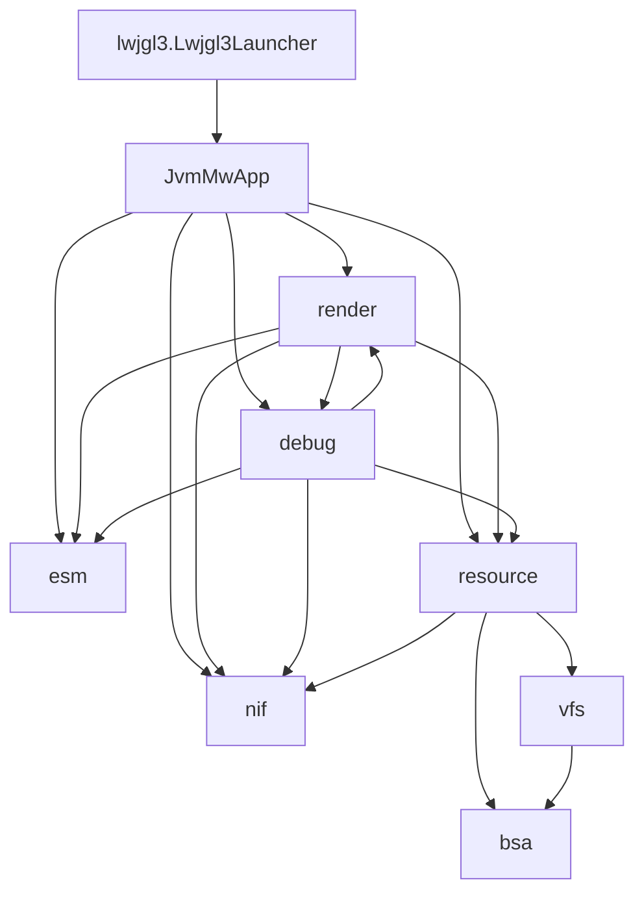
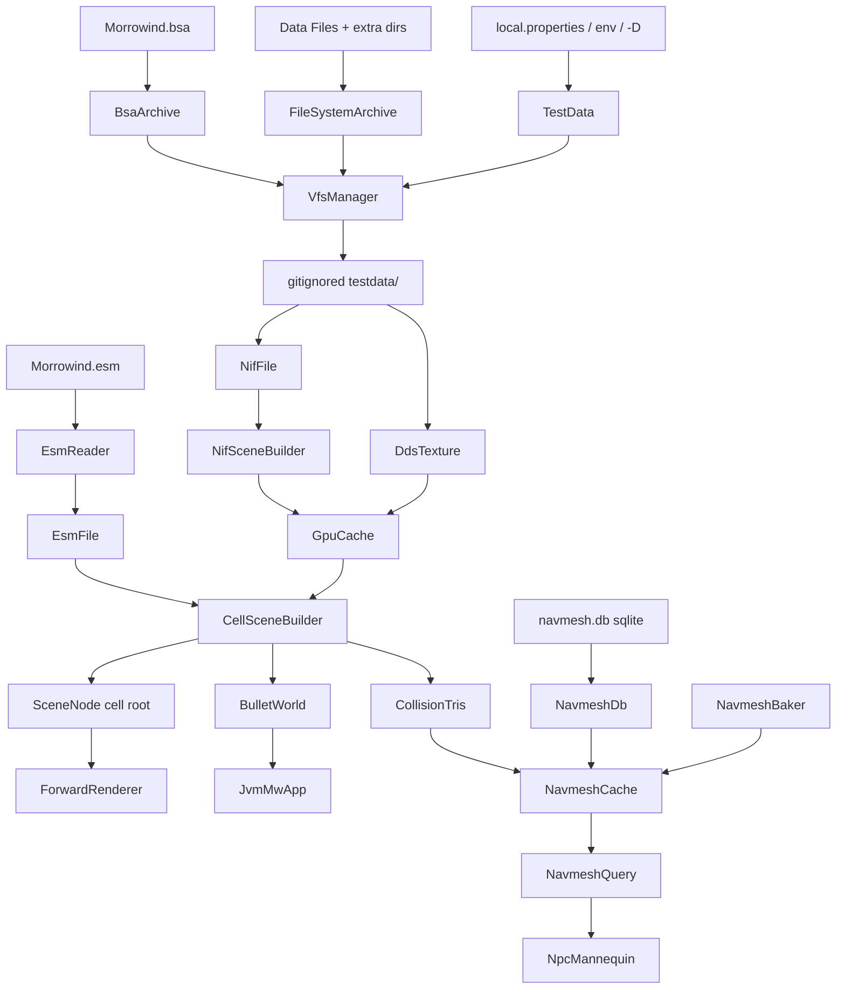

# Architecture

Agent map of this repo. Read this before searching for a class. It says where code lives and which invariants break the viewer if you violate them. Behavior of a subsystem stays in the doc linked below. Do not copy those docs into a phase spec or into Java comments.

Line numbers are the Java tree at `de885af` (same Java as `9485d74`; that commit only added [rendering.md](rendering.md)). If a later commit moves a method, trust the file, not a stale number. If a phase spec or a class comment disagrees with the method, the method wins.

There is no `src/test`. `compileJava` is the compile check. Headless checks are `:core:debugCli`.

OpenMW symbol pairs live in [NAME_MAP.md](NAME_MAP.md). Do not add “Maps to …” comments in Java. A file with no port header is not automatically original; see [Port header vs unmarked](#port-header-vs-unmarked).

## Other docs (do not duplicate)

| Doc | Use it for | Do not |
| --- | --- | --- |
| [rendering.md](rendering.md) | One frame, passes, water FBOs, shaders, depth, cull, coordinates | Restate pass rules here |
| [physics.md](physics.md) | Bullet walk, leftover actor capsules | Implement from it; it is a big-topic breakdown |
| [nav-paths.md](nav-paths.md) | Pathgrid and Detour | Implement from it |
| [ai-packages.md](ai-packages.md) | Wander, travel, follow, escort, activate | Implement from it |
| [distant-land.md](distant-land.md) | Why the view is still a 21-cell grid | Implement from it |
| [setup.md](setup.md) | JDK, data path, navmesh.db, keys | |
| [next-topics.md](next-topics.md) | Small slices a user may pick | Spec one until they say proceed |
| [big-topics.md](big-topics.md) | Large holes | Spec as a small phase |
| [AGENTS.md](../AGENTS.md) | Agent rules, placement gotchas, debug CLI table | |
| `docs/phase*.md` | History of one shipped slice | Treat as the current map |

`docs/physics.md` work-order text still says `CollisionWorld`. That class is not in the tree. Player, NPC feet, and live doors are `render.BulletWorld`. The “What Town has now” section of that doc matches the code more closely than the leftover slice instructions.

## Gradle

`settings.gradle` includes `core` and `lwjgl3`. Java 21 (`build.gradle`). Versions in `gradle.properties`: libGDX `1.14.0`, project `0.1.0`. Wrapper is Gradle 9.3.1.

| Module | Role |
| --- | --- |
| `core` | All game code. `java-library`. Depends on `gdx`, `gdx-bullet`, recast4j `recast` + `detour` 1.5.7, sqlite-jdbc 3.47.1.0, lz4-java 1.8.0 (`core/build.gradle`). |
| `lwjgl3` | Desktop window. Depends on `gdx-backend-lwjgl3`, `gdx-platform` natives-desktop, `gdx-bullet-platform` natives-desktop, and `project(':core')`. `application` plugin. Main class `io.github.jvmmw.lwjgl3.Lwjgl3Launcher`. |

Tasks agents actually run, from the repo root (working dir is the repo root for both `run` and `debugCli`, so `local.properties` resolves):

| Task | What |
| --- | --- |
| `compileJava` / `:core:compileJava` | Compile. No test suite. |
| `lwjgl3:run` | Window. macOS adds `-XstartOnFirstThread` in `lwjgl3/build.gradle`. |
| `:core:debugCli --args="help"` | Headless. Main `io.github.jvmmw.debug.DebugCli`. Registered in `core/build.gradle` (`debugCli`). |
| `:lwjgl3:jar` | Fat jar `jvm-mw-0.1.0.jar`. |

`debugCli` commands (`DebugCli.main`, `core/src/main/java/io/github/jvmmw/debug/DebugCli.java:58`): `nif`, `cell`, `interiors`, `spawn`, `npc`, `crea`, `actor`, `levc`, `kf`, `exterior`, `pgrd`, `navdb`, `navpath`. When to use each: [AGENTS.md](../AGENTS.md). `main` also runs `AiPackage.check*` self-checks before the command (`49`).

## Modules and packages

`debug` and `render` import each other. `DebugCli`, `KitSeams`, and `NavmeshDbDump` call into `render`. `ForwardRenderer`, `NpcMannequin`, `BulletWorld`, and `CellSceneBuilder` call `PerfTrace` / `FrameProfiler` / `DebugVars`. Do not “extract debug” without breaking that cycle.

`esm` and `nif` do not import `render`. `bsa` does not import other `jvmmw` packages. Physics and nav are classes inside `render/`, not packages. Leave them there unless a task says to move them.

| Package | Owns |
| --- | --- |
| `io.github.jvmmw` | `JvmMwApp` (viewer), `AwtText` (loader caption raster). |
| `io.github.jvmmw.lwjgl3` | `Lwjgl3Launcher` (GL 3.3, 1280×720, vsync, depth 24, no stencil, no MSAA). `StartupHelper` is third-party Apache (damios), not this port: restart the JVM for macOS `-XstartOnFirstThread`, Windows native extract, Linux NVIDIA `__GL_THREADED_OPTIMIZATIONS=0`. |
| `bsa` | `BsaArchive`. Morrowind BSA (`header id 0x100`). Lookup by lowercase path. Extract one file to a dest. |
| `vfs` | `VfsManager` (last registered source wins), `FileSystemArchive` (loose files). |
| `resource` | `TestData` (data path, VFS mount, HUD cell names, extract-to-`testdata/`), `DdsTexture` (DDS upload), `TexturePaths` (mesh/texture path fixups). |
| `esm` | ESM records the viewer uses. Not a full plugin list. One `Morrowind.esm` per load. |
| `nif` | `.nif` / `.kf` records. Parse only. No GL. |
| `render` | Scene graph, GPU meshes, forward frame, cell build, actors, Bullet, Recast/Detour, sky, water, doors, containers, take. |
| `debug` | Headless CLI, F3/F4 numbers, `DebugVars`, seam dump. |

Largest classes, by line count at this commit: `NpcMannequin` 2106, `ForwardRenderer` 1603, `JvmMwApp` 1590, `EsmFile` 1176, `BulletWorld` 1030, `CellSceneBuilder` 935, `NifFile` 819. Actor behavior is `NpcMannequin`, not `JvmMwApp`.

## Data flow

Bytes the GPU needs are extracted to gitignored `testdata/` (`TestData.openPath` → `VfsManager.Bsa.open` extracts once). Do not commit `testdata/`, ESM, BSA, or `navmesh.db`.

## Startup and the frame

`Lwjgl3Launcher.main` (`lwjgl3/.../Lwjgl3Launcher.java:13`) may return immediately if `StartupHelper.startNewJvmIfRequired()` spawned a child. Otherwise it builds a `JvmMwApp` and a focus listener that calls `setWindowFocused`.

`JvmMwApp.create` (`166`): `BulletWorld.initNatives()`, camera 50° / near 1 / far 8000 (far is replaced when a cell frames), `new ForwardRenderer()` (compiles three programs, allocates two 512 water FBOs, loads sky), `buildUi()`, then `requestLoad("ext:-2,-9")` (Seyda Neen). Input is an `InputMultiplexer`: key adapter, click-to-capture, then the Scene2D stage (`269`).

`JvmMwApp.render` (`1217`) order: `FrameProfiler.beginFrame` (which calls `PerfTrace.beginFrame`), `pumpLoad`, `pumpWalkLoad`, `handleCamera`, `maybeRecenterGrid`, `camera.update`, clear, `CellSceneBuilder.update` when not loading, `ForwardRenderer.render`, one `glGetError`, `ForwardRenderer.resetForScene2d`, Scene2D, `endFrame`. On frame 20 after a load, `dumpFrame` writes `build/phase6-<name>.png` (cell) or `build/phase2-<name>.png` (single mesh) (`1314`). That is not F3.

What the GL pass does (water maps, pass 0/1/2, sky, depth): [rendering.md](rendering.md). Do not re-derive it from `docs/phase21`–`phase35`; two of those already disagree with the code, and [rendering.md](rendering.md) records which.

## `JvmMwApp` map

`core/src/main/java/io/github/jvmmw/JvmMwApp.java`. Scene2D is the HUD only. The 3D pass is `ForwardRenderer`.

| Lines | What |
| --- | --- |
| `83–164` | Fields. Load keys are `cell:<name>` or `ext:<x>,<y>` or a VFS `.nif` path. `takenKeys` survives cell swaps. `walkGen` invalidates a stale walk-parse thread. |
| `166–271` | `create`. Keys: Esc captures the mouse (releases it while loading), F3 snapshot, F4 perf HUD, F5 pathgrid, F6 nav carpet, F7 Bullet wire, R escort, E activate, `[` `]` hour, wheel dolly. WASD is not here. |
| `280–410` | `requestLoad` / `pumpLoad` / `disposeScene`. A cell key waits until `pendingVisibleFrames` reaches 2 (`339`) so the loader overlay can paint, then `load`. `pumpLoadBody` calls `cellBuilder.step(12_000_000L)` (12 ms) until `end()`. |
| `411–437` | `loadMesh`. One `.nif`, `NifSceneBuilder.build()` (Z-up rotate on), no `CellSceneBuilder`, no Bullet. Chair / Shack / Tree / Glass / Banner / Dwrv. |
| `439–517` | `loadCell` / `loadExterior`. `LevelledCreatures.forget()`, dispose, parse ESM on the GL thread, `CellSceneBuilder.begin`, `cellStepping = true`. Census passes two names (`453`); `EsmFile.loadInterior` returns the first hit in that array (`esm/EsmFile.java:112`). |
| `527–556` | Door teleport. Same cell: `placeEye`. Other interior: `cell:` load with `doorArrival`. Empty dest cell: `ext:` grid from `LandRecord.cellGrid` on the dest point. |
| `558–814` | Walk streaming. `maybeRecenterGrid` uses `LandRecord.newGridCenter`. Parse runs on daemon thread `walk-grid` (`598`). GPU build stays on the GL thread with `deferBullet = true` (`660`) so the live Bullet world is not wiped until swap. Swap: `takeWanderFrom`, `attachLiveCollision`, `keepWalkCamera` (`689–707`). A second crossing during a load is stored in `walkPendingGx/Gy` and started by `startPendingWalk`. |
| `830–934` | Camera frame. Cell far: interior `max(8000, 7168+256)`, exterior `40000` (`856`). Spawn order: door arrival, else inbound `hasSpawn`, else a teleport door, else AABB. `placeEye` (`903`): GL eye `(tesX, tesZ + 96, -tesY)`. `snapWalk` calls `BulletWorld.snapSpawn`. |
| `936–1136` | HUD. Buttons: Chair, Shack, Tree, Glass, Banner, Dwrv, Cell (Census), Cave (Addamasartus), Nix (Punsabanit), Guild, Town `(-2,-9)`, Zain, Manor, Club. Hour slider / Play. Dump, Copy pos. Bottom-right 5×5-minus-corners bars (`updateWalkTiles`, `756`). Top-right `FrameProfiler` + `DebugVars`. Center aim name. Loader caption is `AwtText`, not the bitmap font. |
| `1217–1312` | `render`. See above. |
| `1314–1443` | Frame-20 PNG. F3 `snapshotText` / clipboard / `build/debug-snapshot.txt`. |
| `1481–1544` | `handleCamera`. Mouse look only if the cursor is captured, the window is focused, and a load is not running. WASD / arrows move in the horizontal plane; Space / Ctrl are vertical; scroll dollies along look. Exterior speed scale is 9 (shift 30); interior is 1 (shift 10) (`1494`). If `cellBuilder` is set, movement goes through `BulletWorld.move` only when `readyAtGl` is true for the current feet and the destination (`1531`). A single-mesh preview has no `cellBuilder`, so the eye is translated with no collision (`1542`). |
| `1547–1589` | `resize`, `pause` (releases cursor), `dispose` (scene, walk builder, Bullet world and interned shapes, renderer, stage). |

`autoCycling` is never set true (`136`, only assigned `false`). The `AUTO` array (`85`) does not run. Frame 20 still writes the PNG.

`isLoading` is `cellStepping` or a pending `cell:` / `ext:` key (`284`). A single-mesh load is synchronous inside `loadMesh` and does not take that path.

## `ForwardRenderer` map

`core/src/main/java/io/github/jvmmw/render/ForwardRenderer.java`. Draw rules: [rendering.md](rendering.md). This is only where the methods sit.

| Lines | What |
| --- | --- |
| `36–158` | Constants (`MAX_LIGHTS` 8, 2 px cull, 7168 view distance) and GL locations for three programs. Water hold flag, reflect matrix, FBO ids. `ClearCycle cycle` is public; the HUD slider writes it. |
| `160–286` | Constructor. Compile world, water, sky. Load `textures/omw/water_nm.png` from `assets/` (the only shipped texture). Alloc 512 reflection and refraction FBOs. Load four sky pieces; a failure nulls that piece and the frame continues. |
| `288–394` | `render`. Evaluate the hour, optional refraction then reflection, sky, pass 1, pass 0, water plane, pass 2. Profiler section ids match `FrameProfiler`. |
| `397–446` | `bindLighting`, `bindFog`. Exterior density 0 leaves fog off. Underwater fog is a separate branch. |
| `454–532` | `renderReflection`, `renderRefraction`. |
| `534–747` | `drawNode` and cull helpers (`frustumCulled`, `featureCulled`, `beyondViewDistance`). |
| `747–935` | Water draw, water AABB, `waterInView`, ray classify. |
| `937–1078` | `drawSky`, `bindClosestLights` (8 nearest), texture unit bind. |
| `1086–1136` | `dispose` deletes programs, FBOs, sky, then `GpuCache.dispose` (`1120`). `resetForScene2d` (`1124`) so the HUD batch is not left in the 3D GL state. |
| `1140–1232` | FBO alloc, shader compile. |
| `1234–1603` | Shader source, in the class, not files. `VERT` `1234`, `FRAG` `1263`, `WATER_VERT` `1392`, `WATER_FRAG` `1412`, `SKY_VERT` `1542`, `SKY_FRAG` `1568`. All `#version 330`. |

`WATER_FRAG`’s own comment (`1414`) names OpenMW’s compatibility water shader. The class has no port header. Treat the string as derived. Details and the GL-Y vs TES-Z underwater split: [rendering.md](rendering.md).

## Other large classes

### `CellSceneBuilder` (`render/CellSceneBuilder.java`, 935)

Builds one `SceneNode` named `cell-root:<name>`. `begin` (`111`) sets that root to −90° X (`129`), copies ambient, configures fog (exteriors force density 0, `156`), and attaches `WaterMesh` only when the cell is exterior (`164`).

`step` (`170`) phases in `gpu`:

| `gpu` | Work |
| --- | --- |
| 0 | Exterior land tiles via `LandMesh.attach`, one per budget slice. |
| 1 | `place` each ref (`652`). |
| 2 | `finishPrep` (`366`): world matrices, `CollisionTris.bake`, lights, `NavmeshCache.request`, collision tile order. Live loads also `BulletWorld.rebuild` here. Returns false so the next frame does collision. |
| 3 | Spawn-cell collision. `deferBullet` cooks `BulletWorld.Staged` and does not adopt yet. Otherwise adopt now and set `bulletLive`. |

`place` (`652`): hidden markers skipped; ids in `actorIds` go to `NpcMannequin.build` / `buildCreature`; `LEVC` goes to `placeLevc` (player level `EsmLevc.PLAYER_LEVEL` = 1); other ids need an `EsmObject`. Takeables already in `takenKeys` are not placed. Doors register with `DoorSwing`, containers with `ContainerOpen`, takeables and books with `ItemTake`. Non-empty collision goes to `pendingCol`. `livePose` (`905`) is DOOR, CONT, and takeables, so Bullet follows those nodes; other meshes stay at the load pose.

`update` (`280`): neighbor collision budget 4 ms (`pumpCollision`), F7 meshes, nav pump, NPC/creature tick, water follow, door and chest animation, `updateWorld`, `BulletWorld.syncFollowers`. A door that hits the player updates the world twice (`306`).

`activateLooking` (`543`) picks the closest of actor, door, container, item. A closer actor only logs packages. `commandEscort` (`572`) is the R key.

`dispose` (`909`) drops this cell’s land meshes, water, mannequin, debug overlays, and staged Bullet. It does not call `GpuCache.dispose`.

`gpuPhase` (`603`) is the loader string: `loading land`, `loading models`, `loading collision`.

### `NpcMannequin` (`render/NpcMannequin.java`, 2106)

Dressed skeleton, not `NPC_.MODL`. Creatures use `CREA.MODL` (x-prefix when that kf exists). Class comment at `45` is the behavior summary; package rules in depth are [ai-packages.md](ai-packages.md) and [nav-paths.md](nav-paths.md).

| Lines | What |
| --- | --- |
| `67–193` | Body-part slot ids and per-actor state. |
| `274` | `build` NPC. `367` `buildCreature`. |
| `413` | `update`. Front package only. |
| `487–633` | Finish / repeat, wander hours, standing idle roll. |
| `653–801` | `wander`, `travel`, shared `stepPath`. |
| `814–977` | `follow`, `escort`, follower test. |
| `990–1270` | Arm a walk, pathgrid dest, straight dest, `followDetour`, turn. |
| `1285` | `stickLand` (Bullet down hit). |
| `1341–1368` | Skeleton path. |
| `1370–1491` | R escort, E package text, crosshair name. |
| `1493–1730` | `describe` / `describeCreature` (CLI text), auto-equip, racial skin. |
| `1743–2017` | kf play, pose, CPU reskin, `cloneTree`. |

Walk clips move `Bip01` / `root bone` in XY; the pose zeros that so the loop does not yank the actor. They still walk through shacks. Feet use Bullet.

### `EsmFile` (`esm/EsmFile.java`, 1176)

One scan of `Morrowind.esm` per call. There is no parsed-ESM cache. `loadInterior` (`78`) and `loadExterior` (`136`, radius `CELL_GRID_RADIUS` = 2) are the entry points. `load` (`64`) has no callers and skips every record that is not placeable. Do not use it to load a cell.

`inCellGrid` (`233`) is a Chebyshev disk. When `radius >= 2` the four corners are dropped, so a radius-2 load is 21 cells.

Records read: placeables (`isPlaceable`, `56`: STAT DOOR CONT MISC BOOK LIGH ACTI ALCH INGR WEAP APPA ARMO CLOT LOCK PROB REPA), `NPC_`, `CREA`, `LEVC`, `RACE`, `BODY`, `LTEX` (exterior), `CELL`, `LAND` (exterior), `PGRD`. Anything else is `skipRecord`.

Cells that are outside the request still run `harvestRefs` (`964`) so `noteInbound` (`996`) can record the first teleport door whose dest is that interior. `applySpawn` (`392`) copies that door’s dest onto `LoadedCell.spawnPos`. That is the arrival point, not the cell center. Exterior Town spawn is `applyCensusExitSpawn` (`1003`): the Census door whose id is `chargen door exit` (or the first empty-dest teleport in that cell) when its dest falls in the loaded center cell.

Nested types at the bottom: `LoadedCell` `1114`, `GridTile` `1141`, `InteriorSummary` `1152`.

The class comment at `20–21` says wander is a straight line and the pathgrid is dump-only. That is false. `NpcMannequin` walks `PathgridGraph`. Do not “fix” wander back to a straight line because of that comment.

### `NifFile` (`nif/NifFile.java`, 819)

`parse` (`22`) accepts NetImmerse or Gamebryo headers and versions `NifStream.VER_MW` or `VER_4_0_0_0` only. `create` (`65`) builds real records for nodes, shapes, strips, materials, textures, skin, keyframe, text keys. Particles, most extra controllers, and several properties are stubs that exist so the reader can skip them. They do not draw. Root `NiNode` (record 0, not the bone named `bip01`) stays identity (`NifFile` class comment).

## Load path: VFS, ESM, NIF, DDS, GPU

Config keys, in order env, then `-D`, then gitignored `local.properties` (`TestData.configured`, `183`):

| Key | Env | Meaning |
| --- | --- | --- |
| `jvmmw.data` | `JVMMW_DATA` | Data Files folder. Default `.` if unset. ESM is `<data>/Morrowind.esm`. |
| `jvmmw.data.extra` | `JVMMW_DATA_EXTRA` | `;`-separated loose dirs. Missing dirs print and are skipped. |
| `jvmmw.navmesh` | `JVMMW_NAVMESH` | `navmesh.db`. Else `Documents/My Games/OpenMW/navmesh.db`, else `~/.config/openmw/navmesh.db` (`TestData.navmeshDb`, `70`). |
| `jvmmw.debug.<name>` | `JVMMW_DEBUG_<name>` | `DebugVars`. Dots become underscores in the env name. |

VFS build (`TestData.vfs`, `131`): `Morrowind.bsa` if present, then the data dir, then each extra dir. `VfsManager.buildIndex` (`67`) lets the later source replace the same lowercase path. `normalize` lowercases and flips backslashes.

`TestData.ensureNif` (`111`) extracts the nif and every external `NiSourceTexture`, after `TexturePaths.correctTexturePath`. `DdsTexture.load` uploads every mip before it enables the mip filter (`resource/DdsTexture.java` class comment). Setting the filter earlier leaves new land white.

`GpuCache` (`render/GpuCache.java`): process-lifetime maps of DDS, `NifSceneBuilder`, static mesh templates (`build(false)`), and bone templates (`buildBones`). Cell swaps must not dispose these. Skinned copies and land blend maps are per cell and do go away (class comment, `20`). A 1×1 white texture is created on first `whiteId`.

`NifSceneBuilder.build(boolean convertZUp)` (`69`): `true` adds the −90° X (single-mesh HUD). Cell instances use `false` because the cell root already rotated. `buildBones` skips triangle upload. Flatten copies material, alpha, stencil cull, and textures onto `MeshGpu`. Do not transpose `NiTransform.toMatrix` (`nif/NiTransform.java:34`). Skin bind is `readPacked` (rotation, then translation, then scale), not `NiAVObject` order.

`MeshGpu` is the VAO. Stride is 12 floats (`STRIDE_FLOATS`, `84`): position, normal, uv, color. `dynamic` is for skinned copies. Shared chairs and trees are static.

`SceneNode` (`render/SceneNode.java`): `local`, `world = parent * local`, mesh list. `actor` makes water reflection skip the node. `skipMeshes` is collision or marker data. `debugDraw` is pathgrid / nav overlay; water cameras skip it. `updateWorld` is called from the app, not from the renderer.

`EsmTransforms.setLocal` (`render/EsmTransforms.java:27`): translate ESM position, then yaw / pitch / roll about `(0,0,-1)`, `(0,-1,0)`, `(-1,0,0)`, as `QX.mul(QY).mul(QZ)`, then scale. Do not swap in the OSG token order.

`TexturePaths.correctActorModelPath` (`49`): if `x<name>.kf` is in the VFS, it returns the `x` nif path. `CellSceneBuilder.placeMesh` (`919`) uses that path only when the `x` nif itself is also in the VFS. Chest lids need that extra data dir. Without a `containeropen` group, `ContainerOpen.activate` (`148`) logs `no containeropen` and does not change `opened`.

## Cells, interiors, exteriors

HUD interior: `loadCell` → full ESM scan → stepped `CellSceneBuilder`. Arrival is inbound DODT when `hasSpawn`. Census office is a short interior; fog at density 0.75 starts far enough that you may see none. Addamasartus is the fog test (see [AGENTS.md](../AGENTS.md)).

HUD exterior and walk recenter: `loadExterior` builds the 21-cell set (`EsmFile.CELL_GRID_RADIUS`). Land is 65×65 heights, cell size 8192 (`LandRecord`). Recenter stays on the current center while Chebyshev distance to that cell’s center is `<= 4096+1024` (`LandRecord.newGridCenter`, `51`).

Streaming does not keep overlapping scene nodes. The new grid is built beside the live one, then the old `CellSceneBuilder` is disposed. Textures and static NIF templates stay in `GpuCache`. Live tiles are rebuilt. That hitch is the “Keep overlapping tiles” row in [next-topics.md](next-topics.md). Distant land is [distant-land.md](distant-land.md): there is no terrain outside those 21 cells.

Neighbor Bullet is filled after the center cell is ready, from `update` → `pumpCollision`, center tile first (`buildColOrder`, `403`). WASD and wander do not move on a cell where `BulletWorld.readyAt` is false.

`takenKeys` is one set on `JvmMwApp`, assigned into each builder (`464`, `505`, `659`). A taken item stays gone after a cell swap. There is no inventory.

## Bullet and nav (both in `render/`)

Bullet numbers and the deleted custom tracer: [physics.md](physics.md). Code: `BulletWorld`.

`BulletWorld` (`45`) is a `btCollisionWorld`, not rigid-body dynamics. Masks: `WORLD`, `HEIGHT_MAP`, `ACTOR`, `PROJECTILE` (`46`). Player sweeps use `WORLD | HEIGHT_MAP` only (`61`), so the capsule does not hit actors. Constants: eye 96, height 128, radius 30, step up 34, step down 62, ground offset 1, gravity 627, slope 46° (`51–60`). Land is one triangle mesh per TES tile. Objects are triangle meshes from `CollisionMesh`. `syncFollowers` copies a live node’s pose onto its body (doors, takeables). `remove` drops a taken item’s body. `readyAt` / `markReady` / `markInteriorReady` are what the walk and the camera check. `floorY(x,y,z)` is a HeightMap ray. `hitY` is World plus HeightMap. Fields `onGround`, `floorY`, `ceilY` are the last player sweep, which F3 prints.

`CollisionMesh.intern` (`52`) caches by VFS path. `NC` string extra on a root means no collision (`noCollision`, `93`). `RootCollisionNode` is preferred when it has children. Recast does not use Bullet; it copies those triangles once into `CollisionTris` (`24`) at `finishPrep`.

Nav: [nav-paths.md](nav-paths.md). Code, all under `render/`:

| Class | Role |
| --- | --- |
| `EsmPathgrid` / `PathgridGraph` | ESM graph and A*. In `esm/`, used by wander. |
| `PathgridDebug` | F5 spheres and edges. Off at load. |
| `NavmeshDb` | Read `navmesh.db`. Do not commit the file. |
| `NavmeshCache` | Keeps tiles across a 5×5 move. Threads `navmesh` (sqlite) and `navmesh-patch` (rebake), `NavmeshCache.java:46` and `51`. |
| `NavmeshBaker` | Recast. Fallback bake if the db is missing. Patch of cracked tiles. |
| `NavmeshGaps` | Which tiles fail a TES cell-edge cover test. |
| `NavmeshQuery` | Detour polyline. `lastPath` is F3 `navPath`. A miss stays a straight line. |
| `NavmeshDebug` | F6 carpet. Off at load. Red square while a tile rebakes, then green. |

`CellSceneBuilder.startNavmesh` (`314`) calls `NavmeshCache.request`. `navSource` is `none`, then `db` if tiles were already cached, then `load` once a request starts (`318`). F6 builds the carpet meshes only while it is on.

## Input, camera, Scene2D

Keys and the HUD are `JvmMwApp`, not a separate input class. Polling of WASD is in `handleCamera`, after `stage.setKeyboardFocus(null)` (`1482`), so the HUD does not eat movement. The key adapter returns true for Esc, F3–F7, R, E, and brackets, so the stage does not also see those. Click on empty view captures the mouse; click on a widget does not (`255`). Focus loss releases the cursor (`273`).

`E` (`219`): `activateLooking`. A teleport door’s `consumeInteriorTeleport` then calls `startInteriorTeleport` or `startExteriorTeleport`. Non-teleport doors swing; the leaf is a Bullet body (`DoorSwing` class comment). Closing it on the camera stalls the leaf. Containers play kf groups when those files exist (`ContainerOpen`). Take unparents the mesh (`SceneNode.removeFromParent`) and removes Bullet. Books log only (`ItemTake` class comment). Fixture lights without Carry stay (`EsmObject.isTakeable`, `51`: `LIGH` needs flag `LIGH_CARRY`).

`R` (`212`): `commandEscort` on the crosshair actor. Package details: [ai-packages.md](ai-packages.md).

Hour: `ClearCycle` (`render/ClearCycle.java`). Slider, `[` `]`, and Play. `hoursPassed` counts hours moved forward only. Exteriors copy the cycle into `CellLighting` via `applyExteriorCycle`. Stars after sunset. No other weather. Sunglare is not drawn (`SkySun` class comment: “No sunglare flash yet”).

Aim name: `syncAimName` (`1162`) → `CellSceneBuilder.aimName` → `NpcMannequin.lookName` (`1433`). The look ray hits an actor AABB, then `BulletWorld.blockedSegment` (`770`) hides the name when a world or heightfield triangle sits between the eye and that hit. `nearestPackages` (`1416`, the E key) does not call `blockedSegment`. `blockedSegment` is also the water-view test (`ForwardRenderer.java:926`). The method comment on `770` mentions only water.

## Debug

| Type | File | Role |
| --- | --- | --- |
| `DebugCli` | `debug/DebugCli.java` | Headless. Same ESM/NIF parsers as the viewer. |
| `DebugVars` | `debug/DebugVars.java` | `wanderSpeed` default 3, `creaWanderSpeed` 9, `wanderTurn` 270, `wanderRadius` 900, `nodeWanderRadius` 900, `wanderFrequency` 5, `idleDuration` 2 (`24–49`). 0 radius means ESM `AI_W`. Do not revert defaults a user changed. |
| `FrameProfiler` | `debug/FrameProfiler.java` | Sections: walkStep, update, rttRefract, rttReflect, sky, terrain, opaque, water, alpha, hud (`24`). Overlay averages 60 frames (`WINDOW`, `23`). Wait until `n=60` before reading fps. |
| `PerfTrace` | `debug/PerfTrace.java` | Nested spans. `traceFrame` is this frame. Spans over 50 ms stay in `traceSlow` (16 kept). Over 100 ms logs `perf`. `traceLoad` sums `load.parse`, `load.dispose`, `load.land`, `load.place`, `load.cook`, `load.prep`, `load.adopt`, `walk.parse` (`29`). |
| `NifDump` | `debug/NifDump.java` | `nif` command text. |
| `KitSeams` | `debug/KitSeams.java` | `cell` command: `seam meet` / `gap` / `island` from kit AABBs. |
| `NavmeshDbDump` | `debug/NavmeshDbDump.java` | `navdb`. Writes `build/navdb-*.png`. |

F3 (`debugSnapshot`, `1434`): log, clipboard (`Gdx` clipboard, else AWT), `build/debug-snapshot.txt`. Dump fields include `gl`, `tes`, `grid`, `recast`, `onGround`, `floorY`, `ceilY`, `bullet`, `land`, `world`, `bodies`, `btFloorY`, `btHitY`, fog, hour, `nav`, `tiles`, `src`, `navPath`, `patch`, profiler, `DebugVars`. Gradle Ctrl+C does not write this file. F4 toggles the top-right label (`perfHudOn` defaults true, `124`).

F5 `PathgridDebug.toggleVisible`. F6 `NavmeshDebug.toggleVisible`. F7 `BulletColliderDebug.toggleVisible` (yellow land, orange objects). Meshes for those overlays are built only while the toggle is on.

## Port header vs unmarked

A port header is the comment `Ported to Java from OpenMW` in the first lines. 55 files have it. Absence of the header does not mean the behavior was invented here, and it does not mean the file is a line port.

Header present, by package:

- `bsa`: `BsaArchive`
- `vfs`: `FileSystemArchive`, `VfsManager`
- `resource`: `TexturePaths`
- `esm`: `AiPackage`, `CellRef`, `EsmBodyPart`, `EsmCreature`, `EsmFile`, `EsmLevc`, `EsmNpc`, `EsmObject`, `EsmPartRef`, `EsmPathgrid`, `EsmRace`, `EsmReader`, `LandRecord`, `LandTexture`, `LevelledCreatures`, `PathgridGraph`
- `nif`: `KfFile`, every `Ni*` record type, `NifFile`, `NifKeyMap`, `NifRecord`, `NifStream`, `Skinning`
- `render`: `ContainerOpen`, `DoorSwing`, `EsmTransforms`, `GpuCache`, `ItemTake`, `LandMesh`, `NpcMannequin`, `PathgridDebug`, `WaterMesh`

No header (this repo’s host, or a derived shader/algorithm living in an unmarked file):

- Host: `JvmMwApp`, `AwtText`, `Lwjgl3Launcher`, all of `debug/`, `TestData`, `DdsTexture`
- Scene and GPU: `SceneNode`, `MeshGpu`, `MeshInstance`, `NifSceneBuilder`, `ForwardRenderer`, `CellSceneBuilder`, `CellLight`, `CellLighting`, `ClearCycle`, `SkyAtmosphere`, `SkyClouds`, `SkyStars`, `SkySun`
- Bullet and nav: `BulletWorld`, `BulletColliderDebug`, `CollisionMesh`, `CollisionTris`, `NavmeshBaker`, `NavmeshCache`, `NavmeshDb`, `NavmeshDebug`, `NavmeshGaps`, `NavmeshQuery`
- Third-party: `StartupHelper` (Apache, damios)

Unmarked files whose comments still name OpenMW algorithms (not a complete behavior spec; read the method):

- `ForwardRenderer` water strings (`1414` and the TES remap at `1406`). World `FRAG` is the land/static/actor shader. Full pass list: [rendering.md](rendering.md).
- `ClearCycle` (`129`, `144`) names `WeatherManager` sun percentage and glare fade. Glare fade is computed. `SkySun` does not draw a glare flash.
- `CellLighting` constants name `Water_Underwater*` settings (`14–18`).

`NAME_MAP.md` is where a Java type is paired with a C++ symbol. Some of those rows are `rewrite`. A rewrite row plus a missing header means: behavior was matched on purpose, structure is this repo’s.

## Invariants that confuse agents

Coordinates. ESM and NIF are Z-up. One −90° X on the cell root (`CellSceneBuilder.java:129`). Cell instances call `NifSceneBuilder.build(false)` (`GpuCache.meshTemplate`, `96`). A lone HUD mesh calls `build()` which rotates (`NifSceneBuilder.java:65`). A second rotate, or a transpose of the 3×3, opens cave kit. ESM eulers are `QX*QY*QZ` in libGDX (`EsmTransforms.java:33`). Skin bind is packed order (`NiTransform.readPacked`). Player TES from the GL eye is `(eye.x, -eye.z, eye.y - 96)` (`JvmMwApp.placeEye` and `posLine`). Water-shader TES is a different mapping; see [rendering.md](rendering.md).

Threads. GL thread: frame, `CellSceneBuilder.step`, Bullet adopt, GPU. Daemon `walk-grid`: ESM parse only. `navmesh` and `navmesh-patch`: sqlite and Recast. Do not call GL or Bullet from those workers. `TestData`’s VFS cache is a lazy static without a lock (`131`). The walk thread does not touch it today (`EsmReader.open` reads the ESM path directly). Do not add VFS calls on that thread without a lock.

Loads re-read the whole ESM. `loadInterior` / `loadExterior` construct a new `EsmFile` and scan every record. A walk recenter does that again on `walk-grid`.

Bullet readiness. `handleCamera` zeros horizontal motion when the destination cell is not `readyAtGl` (`1533`). Wander uses the same world. Do not bypass that with a raw `eye.add` on a cell load.

`GpuCache` outlives the cell. `ForwardRenderer.dispose` is what clears it. `CellSceneBuilder.dispose` must not.

`takenKeys` and `LevelledCreatures`. HUD `loadCell` / `loadExterior` call `forget()` (`448`, `486`), so a button re-rolls LEVC. Walk recenter does not call `forget()`. `pickOrRemember` keeps the last pick per marker. Take state is the shared set, not the cell.

F3 vs frame 20. F3 is `debugSnapshot`. Frame 20 is an automatic PNG. `autoCycling` does not advance the `AUTO` list.

Stale comment. `EsmFile` lines `20–21`. Pathgrid wander is live.

Stale doc phrase. `CollisionWorld` in [physics.md](physics.md). The class is gone.

`NifFile` stubs. A successful parse does not mean particles or `NiUVController` animate.

Never `ModelBatch`. The renderer owns the VAOs.

Do not commit `local.properties`, `testdata/`, `build/`, ESM, BSA, or `navmesh.db` (`.gitignore`).

When a change alters behavior a doc in `docs/` describes, update that doc in the same commit. Rendering changes belong in [rendering.md](rendering.md). Physics, nav, AI, and distant-land changes belong in those docs, not only in a phase file.
