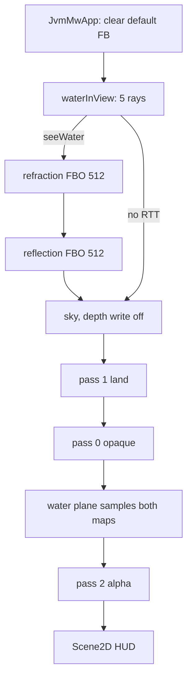
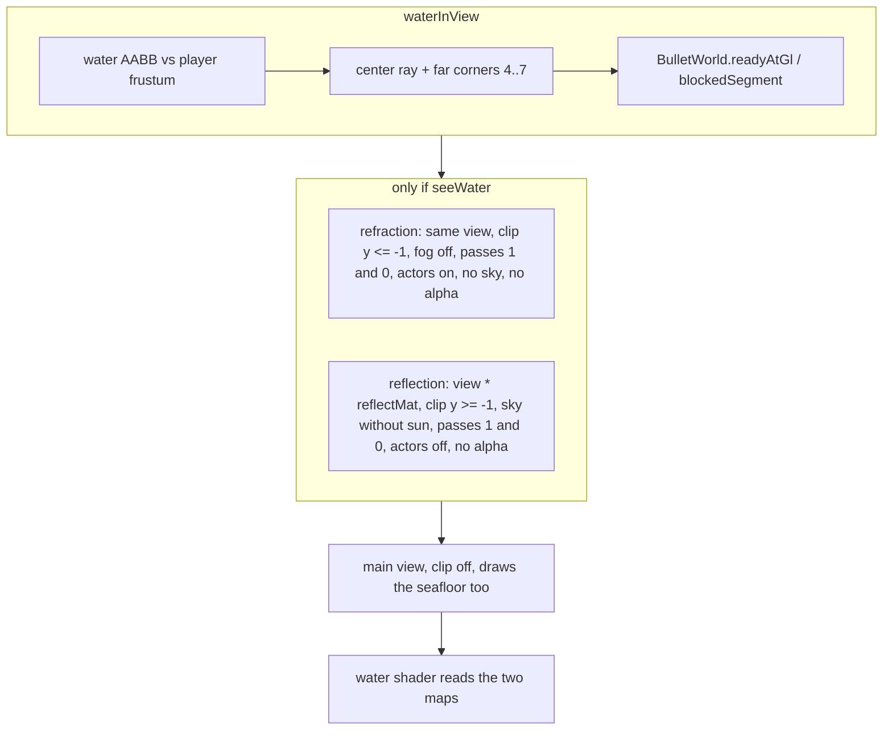

# Rendering

Agent reference for the forward renderer. Verified against `9485d74` (this doc does not change Java). Line numbers are that tree. If a phase spec disagrees with the code, the code wins. Two known drifts:

- [phase31-frustum-cull.md](phase31-frustum-cull.md) says to rebuild the reflection frustum from the reflected `combined` matrix. `renderReflection` does the opposite on purpose (`ForwardRenderer.java:468`).
- [phase33-water-rtt.md](phase33-water-rtt.md) says the main view stays frustum-only. [phase34-small-feature.md](phase34-small-feature.md) added a 2px cull, and that is what `frustumCulled` does now.

OpenMW name pairs live in [NAME_MAP.md](NAME_MAP.md). This file is the Java behavior. Holes that are not in the renderer (shadows, occlusion, distant land, GPU skinning, post) are listed in [big-topics.md](big-topics.md).

Window: `Lwjgl3Launcher` requests GL 3.3, 1280×720, RGBA8, depth 24, no stencil, no MSAA, vsync (`lwjgl3/src/main/java/io/github/jvmmw/lwjgl3/Lwjgl3Launcher.java:19`). libGDX is 1.14.0 (`gradle.properties`). Never `ModelBatch`.

## Where it lives

| Piece | Type | File |
| --- | --- | --- |
| Frame, 3 programs, 2 water FBOs | `ForwardRenderer` | `core/src/main/java/io/github/jvmmw/render/ForwardRenderer.java` |
| Water plane mesh | `WaterMesh` | `render/WaterMesh.java` |
| CPU timings, draw counters | `FrameProfiler` | `debug/FrameProfiler.java` |
| Nested CPU spans | `PerfTrace` | `debug/PerfTrace.java` |
| VAO / material flags | `MeshGpu`, `MeshInstance` | `render/MeshGpu.java`, `render/MeshInstance.java` |
| Node tree | `SceneNode` | `render/SceneNode.java` |
| `.nif` → meshes | `NifSceneBuilder` | `render/NifSceneBuilder.java` |
| Shared textures and static VAOs | `GpuCache` | `render/GpuCache.java` |
| DDS upload | `DdsTexture` | `resource/DdsTexture.java` |
| Land layers | `LandMesh` | `render/LandMesh.java` |
| Cell root, lights, water follow | `CellSceneBuilder` | `render/CellSceneBuilder.java` |
| CPU skin | `Skinning`, `NpcMannequin` | `nif/Skinning.java`, `render/NpcMannequin.java` |
| Fog, 8-light list | `CellLighting`, `CellLight` | `render/CellLighting.java` |
| Clear-day hour | `ClearCycle` | `render/ClearCycle.java` |
| Sky domes | `SkyAtmosphere`, `SkyClouds`, `SkySun`, `SkyStars` | `render/Sky*.java` |
| App frame, HUD, F3 | `JvmMwApp` | `core/src/main/java/io/github/jvmmw/JvmMwApp.java` |

Shader source is Java text blocks at the bottom of `ForwardRenderer`, not separate files: `VERT`/`FRAG` (`1234`, `1263`), `WATER_VERT`/`WATER_FRAG` (`1392`, `1412`), `SKY_VERT`/`SKY_FRAG` (`1542`, `1568`). All `#version 330`. One link each, in the constructor (`161`, `198`, `235`).

## Coordinates

NIF and ESM data are Z-up. One cell root, `buildingRoot`, is rotated −90° about X (`CellSceneBuilder.java:129`). Placed instance NIFs use `NifSceneBuilder.build(false)` (`NifSceneBuilder.java:69`, via `GpuCache.meshTemplate` at `GpuCache.java:96`) so they are not rotated again. A second −90°, or a transpose of the NIF 3×3, opens kit seams. Skin bind data is rotation, then translation, then scale (`Skinning.java:16`, `NifSceneBuilder` class comment).

After the cell root, GL Y is up. The water plane is GL `y = -1` (`WaterMesh.HEIGHT`).

| Space | From GL `(x, y, z)` |
| --- | --- |
| World shader, lights, clip plane, AABBs | GL, Y-up |
| Water shader `v_tesPos`, `u_cameraTes`, `u_sunDirTes` | `(x, -z, y)` (`1406`, `756`, `763`) |
| F3 `tes=` | `(eye.x, -eye.z, eye.y - eyeHeight)` (`JvmMwApp.java:1341`) |

The water shader's TES Z is the eye's GL Y. It is not the feet, and it is not compared to `HEIGHT`. Java "underwater" is `cam.position.y < -1` (`307`). The fragment shader's above/below split is `u_cameraTes.z > 0`, i.e. GL Y > 0 (`1494`, `1521`). Between GL Y −1 and 0 the Java fog path is the above-water path and the shader takes the below-water branch.

`WaterMesh.follow` writes local translation `(eye.x, -eye.z, 0)` (`WaterMesh.java:45`). The node is a child of the −90° root, so the plane stays centered on the camera at GL y = −1. `attach`'s grid arguments are unused (`29`).

## What one frame does

`JvmMwApp.render` (`1217`):

1. `profiler.beginFrame()` zeros section totals and calls `PerfTrace.beginFrame()`.
2. Walk-grid pump (`WALK_STEP`), camera, `camera.update()` (`1230`). Perspective 50°, near 1 (`167`). Exterior far `40000` (`817`, `860`). Interior far `max(8000, 7168+256)` = 8000 (`858`). A bare mesh preview uses `max(8000, moveScale * 20)` (`843`).
3. Clear the default framebuffer to the cell fog color, or `(0.08, 0.09, 0.12)` if there is no mood (`1242`). Depth clears only if the depth mask is true. `resetForScene2d` leaves it false (`1128`); libGDX 1.14 `SpriteBatch.end` sets it true again, and `stage.draw()` runs before the next frame. Skipping the HUD batch without setting the mask true skips the depth clear.
4. `ForwardRenderer.render(cam, root, mood)` if `root != null`.
5. `glGetError` once (`1250`). That call can wait for the GPU. It is inside `FRAME` and outside every named section.
6. `resetForScene2d` (`1124`), then HUD (`stage.act` / `stage.draw`).
7. `profiler.endFrame()`.

`ForwardRenderer.render` (`293`), when `seeWater` is true:



If there is no water node, or `waterInView` is false, refraction and reflection are skipped. The water plane still draws whenever a water node exists (`369`). Interiors never get a water node (`CellSceneBuilder.java:164`), so they skip both RTTs. Sky runs when a water node exists or `lighting.exterior` (`334`). An interior with no water draws no sky.

There is no occlusion pass, no shadow pass, no post pass, and no GPU timer query. Grep of the Java tree finds no `GL_TIME_ELAPSED`, `glBeginQuery`, or `glClipControl`.

## Pass numbers

`drawNode` (`534`) buckets a mesh with:

```text
terrainPass ? 1 : alphaBlend ? 2 : 0
```

| Pass | When | What |
| --- | --- | --- |
| 1 | First world walk | Land. May be alpha-blended (`LandMesh`). Not the leaf pass. |
| 0 | Second | Opaque statics, actors, alpha-test (cutout) meshes. |
| 2 | After the water plane | `alphaBlend` meshes that are not land. |
| sky | Own program, before pass 1 | Not a `drawNode` pass. `skyShader` meshes are skipped in `drawNode` (`554`). |
| water | Own program, between pass 0 and pass 2 | `waterShader` only (`798`). |

Scene-graph order inside a pass. There is no back-to-front sort. `noSorter` only changes whether a blended mesh writes depth (`616`).

Each pass is a full tree walk. Refraction walks pass 1 and 0. Reflection walks pass 1 and 0. The main view walks 1, 0, and 2. No shared visible list.

### State set per world mesh (`573`)

- `u_mvp = cam.combined * node.world`, `u_model = node.world`. `u_view` and lighting and fog are once per pass, not per mesh.
- Textures: unit 0 base, 1 dark, 2 detail, 3 glow, 4 blend map (only if `useBlendMap`). `bindUnit` (`1072`) binds and sets wrap S/T every call. It does not set min/mag filter. There are no sampler objects.
- Material uniforms every mesh: use-flags, `u_uvScale`, ambient/diffuse/emissive, alpha, color mode, alpha test, coverage adjust, depth bias.
- Eight nearest lights, recomputed per mesh (`1018`).
- Cull on unless `mesh.cull` is false. Front face is `frontClockwise` (`MeshInstance`, default false → `GL_CCW`). Reflection flips it (`601`) because the mirror reverses winding.
- Depth test on if `depthTest || depthWrite`, function `mesh.depthFunc` (default `GL_LEQUAL`, `MeshGpu.java:72`) or `GL_ALWAYS` if the test flag is off.
- Blend off and depth mask = `depthWrite` for opaque. For blend: enable, `blendSrc`/`blendDst`, depth mask = `depthWrite` if `terrainPass`, else `noSorter && depthWrite`.
- `GL_POLYGON_OFFSET_FILL` factor 1, units 1, only when `terrainPass` (`621`).
- `glDrawElements` of `mesh.primitive` (triangles), `GL_UNSIGNED_SHORT`, `indexCount`.

`u_depthBias` is `4e-5` for land and `0` otherwise (`594`). It is added in the log-depth write, on top of the polygon offset.

Left body parts get `scale(-1, 1, 1)` and `frontClockwise = true` (`NpcMannequin.java:1641`). Other meshes stay CCW. Normals are `mat3(u_model) * a_normal` with no inverse-transpose (`1256`). A non-uniform scale skews them.

## Culling

`frustumCulled` (`649`) returns true to skip the draw.

1. Invalid local AABB (`localMin[0] > localMax[0]`, empty vertex list) always draws.
2. `debugDraw` nodes (pathgrid, navmesh carpet, Bullet shapes) are frustum-only. They are not submitted at all when `reflection || waterRtt` (`539`). Name checks also skip those nodes when the overlay is off (`542`).
3. Feature size, then distance, then frustum. A frustum miss returns before the other two flags are combined, but any of the three skips the draw and calls `addCulled`.

Feature test (`689`): bounding-sphere radius is half the AABB diagonal. Center is multiplied by `cam.view`. If `abs(viewZ) <= radius`, keep. Else

```text
pixels = radius * viewportPx / (abs(viewZ) * 2 * tan(fov/2))
```

`viewportPx` is the window height on the main view and `512` during either RTT. Thresholds: `CAMERA_FEATURE_PIXELS = 2` (`40`), `WaterMesh.RTT_FEATURE_PIXELS = 20` (`21`). FOV is the camera's vertical 50°. Width is not used. Land (`terrainPass`) is exempt. During reflection, `cam.view` already includes `reflectMat`, so the center is mirrored by that multiply.

Distance (`717`): squared distance from the camera to the AABB, 0 if the camera is inside. Drop when it exceeds `7168²` (`CellLighting.VIEW_DISTANCE`). Land is exempt. A mesh whose longest world axis is ≥ 128 (`LANDMARK_EXTENT`, `709`) is exempt (trees, shacks). The test uses the unmirrored box and the real camera position. The camera is not moved for the reflection pass.

Frustum: `MeshGpu.expandWorldAabb` (`224`) transforms the 8 corners by `node.world` and tests `cam.frustum.boundsInFrustum` (libGDX: false only when all 8 corners are outside one plane). On the reflection pass the box is mirrored over `y = -1` first (`675`): `y' = 2*HEIGHT - y`. The frustum object stays the player frustum. `renderReflection` does not call `camera.update()` or `syncFrustum` until after the matrices are restored (`490`). Rebuilding the frustum from the reflected `combined` inverts the planes and culls everything but sky; that comment is the constraint.

Not culled: sky (`drawSkyNode` has no test), the water plane (`drawWaterNode` has no test).

No GPU occlusion. No object-vs-water-plane test. A mesh entirely above the water is still submitted in the refraction pass; `gl_ClipDistance` drops its fragments.

`drawsCulled` sums every skipped submission this frame, main and RTT together (`FrameProfiler.java:144`). An opaque or land mesh can be counted up to three times (main + refraction + reflection). An alpha mesh is only in the main pass 2 walk. Actors are not visited on the reflection walk (`535` returns before children).

## Depth

All three fragment shaders assign `gl_FragDepth`. World (`1356`), water (`1536`), sky (`1598`):

```text
log2(max(1e-6, 1 + abs(v_viewZ))) / log2(max(u_cameraFar, 1) + 1) + bias
```

clamped to `[0, 1]`. `v_viewZ` is view-space z (`1255`). libGDX looks down −Z, so the code uses `abs`. `u_cameraFar` is `cam.far` for that draw. At `abs(viewZ) == far` the value is 1, which is also the clear value. Smaller means closer. Tests are `GL_LEQUAL`.

`bias` is `u_depthBias` in the world shader only. Water and sky pass 0. Land in the refraction map is stored with `+4e-5`. `logDepthToView` (`1473`) inverts the formula and does not subtract that bias.

A `#version 330` shader that writes `gl_FragDepth` and does not declare a conservative depth layout cannot use the early depth test. Nothing in this tree declares one. The water plane is 80000 on a side (`WaterMesh.EXTENT`) and is submitted every frame a water node exists, so that shader runs for fragments the depth test will later reject.

A new shader that draws into these buffers and leaves `gl_FragDepth` to the fixed function writes the projection's native z. Those values are not comparable to the log values. The window depth and the refraction depth texture are both log depth, not a copy of the hardware 1/z buffer.

There is no reversed-Z and no `glClipControl`. The default framebuffer is cleared to depth 1. Reflection depth is a `GL_DEPTH_COMPONENT24` renderbuffer, not sampled (`1153`). Refraction depth is a 24-bit depth texture, nearest filter, compare mode `GL_NONE` (`1164`, `787`) so the shader reads the stored number.

## Shaders

### World program

Attributes, all meshes (`MeshGpu.java:124`): location 0 `vec3` position, 1 `vec3` normal, 2 `vec2` uv, 3 `vec4` color. Stride 12 floats. Sky's vertex shader does not read location 1; the VAO still has it.

| Uniform | Set |
| --- | --- |
| `u_mvp`, `u_model` | Per mesh |
| `u_view` | Per pass |
| `u_clipPlane` | `(0,0,0,1)` on the main view. Refraction `(0,-1,0,HEIGHT)`. Reflection `(0,1,0,-HEIGHT)`. |
| `u_lightDir`, `u_ambientLight`, `u_sunDiffuse` | `bindLighting` |
| `u_pointCount`, `u_pointPos[8]`, `u_pointDiffuse[8]`, `u_pointAtten[8]` | Per mesh. `.xyz` of atten is constant, linear, quadratic. `.w` is radius. |
| `u_fogEnabled`, `u_fogStart`, `u_fogScale`, `u_fogColor` | `bindFog` |
| `u_base`..`u_glow`, `u_blendMap` | Samplers 0..4, set once per pass (`347`) |
| `u_useDark`, `u_useDetail`, `u_useGlow`, `u_useBlendMap` | Per mesh |
| `u_ambient`, `u_diffuse`, `u_emissive`, `u_matAlpha` | Per mesh |
| `u_colorMode` | 0 ignore vertex color, 1 emissive, 2 ambient+diffuse and alpha (`1334`) |
| `u_alphaTest`, `u_alphaFunc`, `u_alphaRef` | Cutout. Func 0..7 is always, `<`, `==`, `<=`, `>`, `!=`, `>=`, never (`1310`). Default func 3, ref 0.5 (`MeshGpu.java:68`). |
| `u_uvScale` | Land uses 16 (`LandMesh.TILE_COUNT`). Others 1. |
| `u_adjustCoverage` | 1 when alpha-test and not blending (`593`). Scales alpha by mip level. |
| `u_cameraFar`, `u_depthBias` | Far once per pass. Bias per mesh. |

Fragment order (`1327`): sample base, apply color mode, multiply alpha by material alpha, blend-map alpha, dark map multiply, coverage adjust, alpha test `discard`, write `gl_FragDepth`, detail `* 2`, Lambert sun plus points, glow add, fog mix. Output `frag`.

Blend map UV is `v_uv * (16/17) + 0.5/17`, red channel (`1344`). That matches the 17×17 `GL_R8` image.

Point loop: skip if `dist > radius * 2`. Else `1/(c + l d + q d²) * (1 - quickstep(d/radius - 1))`. `quickstep` is two smoothstep-like squares (`1304`).

Fog (`1384`): `clamp((abs(v_viewZ) - start) * scale, 0, 1)` mixed toward `u_fogColor`.

`gl_ClipDistance[0]` (`1259`): if `u_clipPlane.xyz` is ~0, the distance is 1 (pass). Else `dot(world, plane)`. The main view also disables `GL_CLIP_DISTANCE0` (`329`, constant `0x3000` at `45`). The zero plane is a second guard. Clip is evaluated on the GPU after the draw is submitted.

Clip keep region: reflection `world.y >= HEIGHT`, refraction `world.y <= HEIGHT`. No epsilon.

### Water program

Vertex outputs TES position and view z. No clip distance.

Samplers: 0 normal map, 1 reflection color, 2 refraction color, 3 refraction depth (`750`). `u_screenRes` is the window size, not 512 (`769`). `u_time` accumulates `getDeltaTime` (`294`). `u_sunVis` is `cycle.sunVis` outdoors and 1 otherwise (`765`).

`screenCoords = gl_FragCoord.xy / u_screenRes` (`1479`). The RTT viewport is 512×512 and the projection is the window-aspect camera, so the square texture stores that frustum's NDC. Sampling with window UV hits the same NDC. It is not a 512-pixel photograph stretched onto the window. Distortion offsets are in that UV space (`REFL_BUMP` 0.10, `REFR_BUMP` 0.07 at `1441`) and are not scaled by `512/window`.

Normal: six samples of `textures/omw/water_nm.png` (`assets/textures/omw/water_nm.png`, loaded `218`, linear, repeat). World NIFs do not use a normal map. Texture slots 3, 5, and 6 are logged and dropped (`NifSceneBuilder.java:454`). `NiSpecularProperty` is ignored (`358`).

Fresnel dielectric (`1461`) mixes refraction (0) toward reflection (1). IOR is `1.333` above GL Y 0 and `1/1.333` below (`1494`). Specular is a separate add from the sun direction (`1508`), then optional fog (`1531`). `gl_FragDepth` with no bias. Alpha is 1. The plane is drawn with cull off, blend off, depth `LEQUAL`, depth write on (`788`).

Refraction color is shifted by the normal, then suppressed in shallow water (`1504`, `1514`). Depth tint toward `WATER_COLOR` `(0.090195, 0.115685, 0.12745)` applies only when `cameraPos.z >= 0` (`1523`). Below that the refraction sample is multiplied by 1.5 and clamped. The refraction FBO is cleared to the same `WATER_COLOR` (`505`).

### Sky program

`u_pass`: 0 atmosphere (vertex alpha, `u_emission` = `cycle.sky`), 1 stars (`SkyStars.PASS`, texture × `u_opacity` = `nightFade`), 4 sun (`SkySun.PASS`, texture × `sunAlpha`), else clouds (`SkyClouds.PASS` is 2: scroll V by `u_scroll`, multiply by `cloudEmission`, mix with `u_fogColor`). Draw order in `drawSky` (`960`): atmosphere, stars, sun, clouds.

Depth test `LEQUAL`, depth mask false, blend src-alpha / one-minus-src-alpha, cull off (`954`). View translation is zeroed (`945`) so the domes follow the camera. Sun is omitted when `reflection` is true, or when `sunAlpha <= 0.01`. Stars when not `cycle.night` or `nightFade <= 0.01`. `drawSkyNode` does not call `profiler.addDraw`.

Sky roots are owned by `ForwardRenderer`, not the cell tree. Atmosphere, clouds, and stars are NIFs built with `build(true)` (their own −90°). Sun is a generated quad (`SkySun`).

## Scene data

`MeshGpu` constructor (`86`) uploads an interleaved float VBO and a `short` index buffer. `dynamic == true` uses `GL_DYNAMIC_DRAW` (skinned parts only, `NifSceneBuilder.java:281`). Static meshes and land use `GL_STATIC_DRAW`. Index type is `GL_UNSIGNED_SHORT`. Land is 65×65 (`LandRecord.SIZE`); 64×64×6 indices fit in that type.

`GpuCache` (`25`) interns DDS by VFS path and static NIF templates (`meshTemplate` → `build(false)`). `cloneTree` (`NpcMannequin.java:2002`) shares the `MeshGpu`. Material flags live on `MeshGpu`, not on the instance. Two placements of one chair share the VAO and the material. Skinned copies, land meshes, blend maps, and the water mesh are not in that cache. `GpuCache.dispose` runs from `ForwardRenderer.dispose` (`1120`). `CellSceneBuilder.dispose` releases land, water, and `NpcMannequin.ownedGpus` (`909`).

`DdsTexture.load` (`31`): DXT1/3/5 or uncompressed RGB/RGBA. Min filter stays `GL_LINEAR` and `GL_TEXTURE_MAX_LEVEL` stays 0 until every mip is uploaded, then max level is `count-1` and min filter becomes `GL_LINEAR_MIPMAP_LINEAR` if there is more than one mip (`109`). Setting a mipmap filter on an incomplete texture samples white. Blend maps repeat that rule (`LandMesh.java:251`): `GL_R8`, unpack alignment 1, 17×17, linear, clamp, max level 0, before `glTexImage2D`.

`flattenOnto` (`330`) walks ancestor properties onto the mesh. Alpha blend/test, blend factors, depth, stencil-both and alpha → `cull = false`. Dest blend `GL_DST_ALPHA` is rewritten to `GL_ONE` (`386`). Textures: slot 0 base, 1 dark, 2 detail, 4 glow (`465`). Missing source → 1×1 white (`GpuCache.whiteId`).

`NiTriStrips` are expanded to a triangle index list in `NifFile` (`76`, `431`). `skipMeshes` / root collision nodes are not drawn (`SceneNode.java:15`, `drawNode` `551`).

Land (`LandMesh.attach`, `50`): one 65×65 heightfield in local XZ (height in local Z, so GL Y after the cell root), one draw per distinct LTEX. UV 0..1 across the cell, `uvScale` 16. `terrainPass` set. If more than one texture, every layer is `alphaBlend` with a 17×17 mask. First layer `SRC_ALPHA, ZERO`, `GL_LEQUAL`. Later layers `SRC_ALPHA, ONE`, `GL_EQUAL` (`94`). All of them take polygon offset and the `4e-5` bias. One texture: no blend map, opaque pass 1.

Actors: `placed.actor = true` (`288`, `378`). Reflection returns on that node and does not walk children. Skins are CPU `Skinning.apply` then `MeshGpu.updateVertices` (`MeshInstance.reskin`, `31`), which also rebuilds the local AABB. That runs in `NpcMannequin` during `CellSceneBuilder.update`, inside the `UPDATE` section (`update.skin`, `1894`), before `render`. No GPU skinning.

The renderer does not stream. It draws the `SceneNode` it is given. Exteriors are one root for the 5×5-minus-corners (`EsmFile.CELL_GRID_RADIUS = 2`, `inCellGrid` drops the four corners, `EsmFile.java:29` and `233`). One water plane for that root, not per land tile. Swapping cells swaps the root. `GpuCache` and the two water FBOs survive the swap. Distant land is not built; see [distant-land.md](distant-land.md).

## Lighting and fog

`bindLighting` (`397`): sun direction, ambient, sun color. Null lighting uses a fixed sun and ambient and zero point lights. Exteriors: `ClearCycle.applyLighting` overwrites ambient, sun color, sun direction, and fog color every frame (`114`). It does not set `fogEnabled`. `configureFog(..., 0)` on exteriors (`CellSceneBuilder.java:156`) leaves `fogEnabled` false. Outdoor world and water shaders do not fog. The clear color and the cloud pass still use the cycle fog color.

Interiors: `configureFog(cell.fogColor, cell.fogDensity)` (`47`). `fogStart = 7168 * (1 - density)`, `fogEnd = 7168`, `fogScale = 1/(end-start)`. Density 0 disables fog.

`bindFog` (`415`): `fogOff` forces off (refraction passes `true`). Else if the eye is below `HEIGHT`, underwater fog is forced on. Start is `7168 * (1 - 2.5)` because `UNDERWATER_DAY_FOG` is 2.5 (`15`, `67`), so the start is negative and the eye is already partway into the ramp. Color is `UNDERWATER_COLOR` mixed 0.85 toward the cell fog color (`75`). Else the cell fog uniforms, or off.

Point lights: positions are GL world translations (`finishLights`, `815`). Attenuation stored as constant `0`, linear `3/radius`, quadratic `0` (`828`). Up to 8 nearest, by distance to the mesh AABB center (`1018`). Negative lights flip the diffuse RGB (`822`). Flicker updates in `CellLighting.updateFlicker` before the draw, from `JvmMwApp`.

Sun direction for the world shader is GL (`ClearCycle.lightDirGl`). The water shader is handed `(sunDir.x, -sunDir.z, sunDir.y)`.

## Water



### Why two extra renders

The main pass draws the seafloor. Pass 1 and pass 0 have no clip plane (`345`, `380`). The water shader still needs a picture of what is under the surface, because it cannot sample the framebuffer it is drawing into. Those RTTs also run before the main pass (`309` then `328`), so the window image does not exist yet.

The reflection cannot be copied from the main frame. `reflectMat` (`232`, `130`) is column-major Y scale −1 and Y translation `2 * HEIGHT` (−2). `cam.view` and `cam.combined` are multiplied by it for the reflection pass only (`466`). The camera position does not move. The reflected view sees mirrored, often off-screen geometry. The player framebuffer never contained that image. Sun is skipped so the disc is not in the mirror; the shader still adds a sun specular.

Refraction uses the player view, fog forced off (`516`), clip `y <= -1`, passes 1 and 0 only. No sky, no alpha, actors included (`501`). So the refraction image is unfogged seafloor (and anything else below the plane), not a copy of the main color. The main color, when the water later wins the depth test, is replaced by the shader output. Where land is closer, the water fragments fail `LEQUAL` and the main-pass pixel stays. The shader still runs on those fragments because of `gl_FragDepth`.

Fog is applied once, on the water shader's final color, using the same `bindFog` as the world (`770`). The refraction image itself has fog off. A future copy of the main opaque color would already contain fog, and this shader would fog it again.

### Targets

Both color targets are 512×512 RGBA8, linear, clamp (`1140`, `WaterMesh.RTT_SIZE`). Reflection depth is a renderbuffer. Refraction depth is a texture. FBOs are checked complete at startup (`1191`). They are allocated once in the constructor and reused. Contents stay until the next pass that binds them; a cell swap does not clear them.

`u_cameraFar` on the refraction draw and on the water draw is the same `cam.far` in one frame. `logDepthToView` uses the water draw's far. Changing far between the two breaks the depth tint.

### Gate

`collectWater` (`821`) fills `waterBox` from every `waterShader` mesh's world AABB. `waterInView` (`849`):

- If `waterBox` is outside the player frustum, `holdWater(false)`.
- Else five segments, each from the eye to a far point: `direction * far`, plus `cam.frustum.planePoints[4..7]`. In libGDX 1.14 those four are the far corners (`Frustum` comment: 0..3 near, 4..7 far).
- `classifyWaterRay` (`910`): `t = (HEIGHT - eyeY) / dy` along that segment. Miss (0) if `dy ~ 0`, `t <= 0.02`, `t > 1`, or the hit is outside `waterBox`. If the TES cell under the hit has no Bullet yet (`readyAtGl`, `290`), return 3 (pending). If `blockedSegment` hits with fraction `< 0.97` (`770`), return 2 (blocked). Else 1 (water).

Combine: any 1 sets `waterHold = 45`, `waterShown = true`, and returns true. If none saw, none pending, and at least one blocked, `holdWater(false)` decrements the hold and returns the old `waterShown` until it hits 0. Any other miss (all rays miss, or some pending) returns `waterShown` unchanged and does not decrement.

The world AABB is a flat 80000×80000 square at GL y = −1, recentered on the eye in XZ. It contains the eye only when the eye is on the plane. `boundsInFrustum` fails when that whole square is outside the player frustum. A steep look away from the plane can do that; the pitch where it starts was not measured. That path is the one that calls `holdWater(false)` without a blocked ray.

When the square still intersects the frustum and every ray misses (looking above the plane, so `t` is outside `(0.02, 1]`), nothing is blocked, and nothing is pending, the method returns `waterShown` and does not decrement the hold. After the first hit, those frames leave `waterShown` true, so both RTTs keep running. `ms.rttRefract == 0` in an F3 dump means this frame did not enter the passes (`beginFrame` zeros sections that are not begun).

The plane is drawn either way (`366`). The gate only skips the two scene redraws. There is no occlusion query and no coverage estimate.

### Underwater

Java fog and the `underwater` flag use GL Y < −1. Reflection and refraction both call `bindFog` with `underwater` false (`480`, `516`). Refraction also forces fog off. The shader's underwater look is the `cameraPos.z < 0` branch (GL Y < 0), which is a different test. Clip planes are not flipped when the camera is under the water. Refraction still keeps `y <= -1` and reflection still keeps `y >= -1`.

## Profiling and F3

`FrameProfiler` sections (`10`): `walkStep`, `update`, `rttRefract`, `rttReflect`, `sky`, `terrain`, `opaque`, `water`, `alpha`, `hud`, plus `FRAME` which is not in `NAMES`. `begin`/`end` store `System.nanoTime` deltas (`114`). No `glFinish`, no `GL_TIME_ELAPSED`. A section is CPU time around the submits, including driver time spent inside those calls, not GPU completion. The fattest overlay name is the max among `NAMES` only (`232`).

`addDraw` (`126`): while `setRtt(true)`, increment `draws.rtt` and return (no tri count). Else `draws` and `tris`, and bucket pass 1 / 2 / 0. Pass `-1` (the water plane) counts in `draws` and `tris` only. Sky draws are uncounted. `drawsCulled` is unbucketed.

`fps` is `1000 / mean(frameMs)` over up to 60 frames (`97`). `n` in the overlay is `histCount`. Treat fps as settled at `n=60`.

F3 and the Dump button call `debugSnapshot` (`186`, `1434`): clipboard, log, and `build/debug-snapshot.txt`. Text is camera, fog, `underwater=` (eye below `HEIGHT` and an exterior cell, `1370`), Bullet, nav, `glError`, then `profiler.appendDump`. The dump does not include `waterHold` or `seeWater`. `PerfTrace` adds nested spans (`water.test`, `update.skin`, `load.*`) and keeps spans over 50 ms.

The headless `debugCli` does not create a GL context. It cannot validate a shader or a pass.

## Invariants

- Three programs, two water FBOs, default framebuffer for the main view. No MRT, no MSAA resolve.
- Pass order on the main view is sky, land, opaque, water, alpha. Alpha is last because it blends against what is already in the color buffer. Land blending happens in pass 1, before opaque, with its own blend func and `GL_EQUAL` on later layers.
- `GL_CLIP_DISTANCE0` is enabled only around the RTT world draws (`475`, `508`) and forced off before the HUD (`1125`). Sky in the reflection pass is drawn with clip disabled (`470`).
- Do not rebuild the reflection frustum from the reflected matrix (`468`).
- Do not frustum-cull sky or the water plane.
- Do not drop refraction or set `RTT_SIZE` below 512 without a new phase doc. [phase33-water-rtt.md](phase33-water-rtt.md) lines 33–34 and the out-of-scope list forbid both. The behavior is shipped.
- Shared `MeshGpu` means shared materials. Per-placement data is the `SceneNode` transform and `MeshInstance.frontClockwise` / skin fields.
- DDS and blend maps must be complete before the first sample or the first outdoor frame flashes white (`DdsTexture.java:16`, `LandMesh.java:34`).
- `glGetError` after `render` is the frame's `glError=` (`1250`). A non-zero value is a failed invariant, not a profiler section.

## Divergence

Useful if a change is about to chase the C++ viewer. This renderer is one forward pass with CPU skinning, a fixed 512 refraction and reflection, Clear-day hour only, no shadows, no occlusion, no distant land, no interior water plane (water is attached only when `!cell.interior`). Reflection always skips actor roots; that is not a setting. Exterior mesh fog is off. The log depth write is in every fragment shader.

## Proposals

Not implemented. Do not start these inside an unrelated change. (c) and anything in (e) that shrinks an RTT or skips refraction need a new phase doc that supersedes [phase33-water-rtt.md](phase33-water-rtt.md). Read the local OpenMW pin before copying a constant from it. Do not fetch that tree from GitHub.

(a) GPU timer queries (`GL_TIME_ELAPSED`) per pass. Today every `ms.*` is CPU `nanoTime`. A query would not replace F3; it would add GPU time the CPU sections cannot see. `glGetError` already serializes the frame and sits outside the named sections.

(b) In the water passes, skip objects whose world AABB is entirely on the wrong side of the plane. Refraction would skip objects fully above the water; reflection would skip objects fully below. Flip that when the camera is under the plane. Today only `gl_ClipDistance` drops fragments, after the draw is submitted (`1259`). There is no plane offset in the uniform (`479`, `515`). A bias, if one is added, has to be read from the pin's water clip code. Do not invent the epsilon.

(c) Build refraction from a copy of the main view's opaque color and depth, and delete the refraction pass. That means rendering the main view into an FBO (the window image does not exist yet when today's RTTs run), blitting after the opaque pass, and rejecting a distorted sample whose depth is nearer than the water surface. Fog is already in that color, and `WATER_FRAG` fogs again (`1531`). The current refraction pass avoids both by drawing a clipped, unfogged scene into its own texture. Phase 33 forbids skipping refraction until a phase doc says otherwise.

(d) Fewer CPU calls per draw. `bindUnit` sets wrap with `glTexParameteri` on every texture of every mesh (`1072`). Sampler objects, or setting wrap once at upload when every user of a texture agrees, would move that off the draw. Material and matrix uniforms are uploaded per mesh with no UBO (`571`, `1079`). `frustumCulled` and `bindClosestLights` run again for every pass, including both RTTs. Draws are in tree order, not sorted by program, texture, or blend state.

(e) Cheaper reflection only. Actors are already skipped. Both RTTs already use a 20px cull on a 512 viewport (`659`). Still open: a higher reflection-only pixel threshold, a target whose aspect matches the window (today 512×512 with a window-aspect projection), and skipping the reflection pass when the eye is under the plane (today it still runs). Half-resolution or any `RTT_SIZE` under 512 is a phase-33 change, not a drive-by.

(f) Replace the five Bullet rays with a GPU occlusion query of the water plane, and scale reflection quality from the visible coverage. The rays miss the "looking at the sky" case described above, and they do not measure how many pixels of water survived the depth test.

(g) Reversed-Z with a float depth buffer (`glClipControl`) so the fragment shaders can stop writing `gl_FragDepth` and the early depth test can run. The window is a 24-bit fixed depth (`Lwjgl3Launcher.java:21`). The log formula is what makes far Morrowind distances usable in that buffer (`1355`). Removing the write without replacing the distribution will z-fight at the current far planes (8000 interior, 40000 exterior).

(h) Update the reflection map on a fraction of frames, as a quality option. Today, when `seeWater` is true, both maps are redrawn every frame. The gate already fails to turn them off when rays miss.

(i) Long-term: screen-space planar reflections, with the sky or a low-detail planar pass where the mirror looks off screen. Nothing in the tree gathers screen-space reflection. Not worth doing first: oblique near-plane clipping. Clip is `gl_ClipDistance` in world space (`1258`). An oblique projection matrix would change the near plane the log-depth term does not use (`v_viewZ` is view z, not window z) and would have to be kept in sync with `reflectMat`.

## How to change it

1. Read the method you are editing and the pass table above. Phase docs record what a slice intended. `renderReflection`'s frustum comment overrides phase 31.
2. A new full-screen pass belongs in `ForwardRenderer.render`, with the same state restore the pass you copied ends with (`GL_CLIP_DISTANCE0` off, front face CCW, viewport back to the window, `resetForScene2d` still safe for the HUD).
3. If the pass draws into the window or the refraction depth texture, its fragment shader writes the same log formula with the same `u_cameraFar`, or it does not share those depth buffers.
4. Calling `drawNode` again re-walks the tree, re-culls, and adds to `drawsCulled` / `draws` or `draws.rtt`. That is the current pattern. A shared visible list is proposal (d), not a silent refactor inside a feature.
5. Do not enable `GL_CLIP_DISTANCE0` on the main view. The shader's zero-plane guard is not a license to leave the clip enable on; sky and the HUD do not set `gl_ClipDistance`.
6. Do not sample the framebuffer you are drawing into. The water maps exist for that reason.
7. New profiler sections mean editing `FrameProfiler` `NAMES`, `SECTION_COUNT`, and `appendDump` together. Dump text is what agents compare across runs. Leave `n=60` as the settle point.
8. F3 after a change: `glError=0`, and the `ms.*` / `draws.*` lines still parse. `ms.rttRefract=0` means the gate skipped the pass, not that the GPU was fast.
9. `gradlew.bat :core:debugCli` does not compile or run these shaders.
10. Cell-root rotation, NIF 3×3 copy, and skin packed order are load-time. A render-pass change that "corrects" them will open seams or flatten actors. Those rules are in the `NifSceneBuilder` and `Skinning` class comments.
11. `RTT_SIZE`, "skip refraction", and "skip the water cameras" are phase-33 constraints. Write a phase doc before changing them.
12. Never `ModelBatch`.

## Glossary

| Term | In this tree |
| --- | --- |
| Pass 0 / 1 / 2 | Opaque / land / alpha-blend, `drawNode`'s third argument. |
| RTT | The 512 refraction or reflection framebuffer. |
| `seeWater` | `collectWater` and `waterInView`. Gates the RTTs, not the water plane draw. |
| `waterRtt` | True during both RTT passes. Switches the feature cull to 20px on 512. |
| `reflectMat` | Y-up mirror through `y = -1`, applied to `view` and `combined`. |
| Log depth | The `gl_FragDepth` formula above. Not the projection's native z. |
| `draws` | Submitted main-view draws, including the water plane, excluding sky and RTTs. |
| `draws.rtt` | Submitted draws inside either RTT. Sky not included. Tris not included. |
| `drawsCulled` | Skipped mesh submissions, all walks, this frame. |
| `n` | Frames in the 60-wide CPU frame-time window. |
